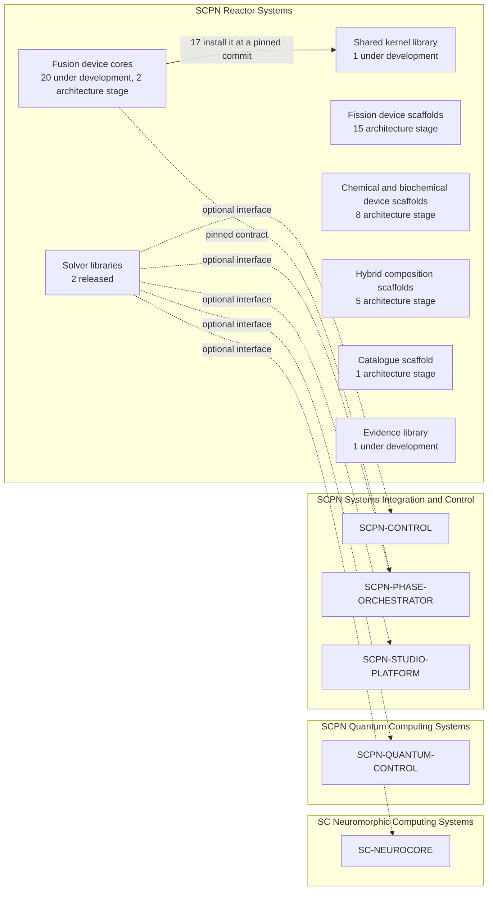

<!--
SPDX-License-Identifier: AGPL-3.0-or-later
Commercial license available
© Concepts 1996–2026 Miroslav Šotek. All rights reserved.
© Code 2020–2026 Miroslav Šotek. All rights reserved.
ORCID: 0009-0009-3560-0851
Contact: www.anulum.li | protoscience@anulum.li
ATLAS REACTORUM — SCPN Reactor Systems group and project map
-->

# SCPN Reactor Systems — group and project map

This page is generated by `metadata/group_map/build_group_map.py` from the dated source
snapshot of 2026-10-12 and is not edited by hand. The same data are in
[`ecosystem_projects.json`](../metadata/group_map/ecosystem_projects.json); how they are
collected and what they do not establish is in the
[group map contract](../metadata/group_map/README.md).

## What the group does

The SCPN Reactor Systems Research Group models reactor systems. It keeps solver libraries, one
shared kernel library, one repository per device family and this atlas of reactor technology.
It has no single workbench: each repository owns one responsibility. A place in the tables
states a responsibility, not that a project is complete, validated or certified.

Lines in the diagram are for navigation. The solid line is a package dependency inside the
group. Dashed lines are optional interfaces or data-only pins that can be checked in the
cited files; none is a hard dependency between groups.

## Where a newcomer starts

- To run something: SCPN-FUSION-CORE, the tokamak solver and control library. Its own README
  states which of its validation lanes are accepted and which are blocked or failing.
- To read about reactor technology with sources: this atlas, a static site with no installation.
- To see how one device family is described: any fusion device core below.

## Words used

- **Status** uses the common scale of the ecosystem. *Released*: a package on the public index
  and a release tag. *Under development*: a public repository without a package release.
  *Architecture stage*: the repository declares `architecture_only`.
- **Declared evidence maturity** is the repository's own statement in its manifest, per
  capability. Neither this atlas nor the group validates it.
- **Not published** means a local repository without a public remote.

## Projects on 2026-10-12

Counts are computed from the data and are the state on that date, never a total or a target: 2 released, 22 under development, 31 architecture stage.

### Solver libraries

| Project | Function | Status | Declared evidence maturity | Repository | Package |
|---|---|---|---|---|---|
| [SCPN-FUSION-CORE](https://github.com/anulum/scpn-fusion-core) | SCPN Fusion Core - Advanced Plasma Physics & Control Suite | released | not declared | public | PyPI scpn-fusion 4.0.0 (beta) |
| [SCPN-MIF-CORE](https://github.com/anulum/scpn-mif-core) | Deterministic phase synchronisation and hardware synthesis for high-beta pulsed magneto-inertial fusion plasmas | released | not declared | public | PyPI scpn-mif-core 0.1.1 (pre-alpha) |

### Shared kernel library

| Project | Function | Status | Declared evidence maturity | Repository | Package |
|---|---|---|---|---|---|
| [SCPN-REACTOR-KERNELS](https://github.com/anulum/scpn-reactor-kernels) | Shared physics and geometry kernels of the SCPN Reactor Systems Research Group | under development | `computational_prototype` | public | none |

### Fusion device cores

Every fusion device core is a public repository without a package release. The
capability count is the number of capabilities its manifest lists as implemented.

| Project | Confinement | Configurations | Capabilities | Status | Declared evidence maturity |
|---|---|---|---|---|---|
| [SCPN-BEAM-TARGET-CORE](https://github.com/anulum/scpn-beam-target-core) | beam target | `beam_target`, `colliding_beam` | 5 | under development | `computational_prototype` |
| [SCPN-IEC-CORE](https://github.com/anulum/scpn-iec-core) | electrostatic | `gridded_iec`, `polywell` | 3 | under development | `computational_prototype` |
| [SCPN-LATTICE-FUSION-CORE](https://github.com/anulum/scpn-lattice-fusion-core) | extension | `scpn.reactor_systems:lattice_confinement_fusion` | 0 | architecture stage | `architecture_only` |
| [SCPN-MUON-FUSION-CORE](https://github.com/anulum/scpn-muon-fusion-core) | extension | `scpn.reactor_systems:muon_catalysed_fusion` | 0 | architecture stage | `architecture_only` |
| [SCPN-FUSION-FISSION-HYBRID-CORE](https://github.com/anulum/scpn-fusion-fission-hybrid-core) | hybrid | `fusion_fission_hybrid` | 5 | under development | `computational_prototype` |
| [SCPN-ICF-BEAM-CORE](https://github.com/anulum/scpn-icf-beam-core) | inertial | `ion_beam_icf`, `pulsed_electron_beam_icf` | 5 | under development | `computational_prototype` |
| [SCPN-ICF-IMPACT-CORE](https://github.com/anulum/scpn-icf-impact-core) | inertial | `projectile_or_impact_icf` | 5 | under development | `computational_prototype` |
| [SCPN-ICF-LASER-CORE](https://github.com/anulum/scpn-icf-laser-core) | inertial | `laser_icf_direct_drive`, `laser_icf_fast_or_shock_ignition`, `laser_icf_indirect_drive` | 5 | under development | `computational_prototype` |
| [SCPN-FRC-CORE](https://github.com/anulum/scpn-frc-core) | magnetic closed | `field_reversed_configuration` | 5 | under development | `computational_prototype` |
| [SCPN-RFP-CORE](https://github.com/anulum/scpn-rfp-core) | magnetic closed | `reversed_field_pinch` | 5 | under development | `computational_prototype` |
| [SCPN-SPHEROMAK-CORE](https://github.com/anulum/scpn-spheromak-core) | magnetic closed | `spheromak` | 5 | under development | `computational_prototype` |
| [SCPN-STELLARATOR-CORE](https://github.com/anulum/scpn-stellarator-core) | magnetic closed | `heliotron`, `stellarator`, `torsatron` | 2 | under development | `computational_prototype` |
| [SCPN-TOKAMAK-CORE](https://github.com/anulum/scpn-tokamak-core) | magnetic closed | `conventional_tokamak`, `spherical_tokamak` | 5 | under development | `computational_prototype` |
| [SCPN-LEVITATED-DIPOLE-CORE](https://github.com/anulum/scpn-levitated-dipole-core) | magnetic open | `levitated_dipole` | 5 | under development | `computational_prototype` |
| [SCPN-MAGNETIC-CUSP-CORE](https://github.com/anulum/scpn-magnetic-cusp-core) | magnetic open | `cusp` | 2 | under development | `computational_prototype` |
| [SCPN-MIRROR-CORE](https://github.com/anulum/scpn-mirror-core) | magnetic open | `gas_dynamic_mirror`, `simple_magnetic_mirror`, `tandem_mirror` | 5 | under development | `computational_prototype` |
| [SCPN-MIF-LINER-CORE](https://github.com/anulum/scpn-mif-liner-core) | magneto inertial | `mechanical_or_liquid_liner_mif` | 5 | under development | `computational_prototype` |
| [SCPN-MIF-MAGLIF-CORE](https://github.com/anulum/scpn-mif-maglif-core) | magneto inertial | `maglif` | 5 | under development | `computational_prototype` |
| [SCPN-MIF-PLASMA-JET-CORE](https://github.com/anulum/scpn-mif-plasma-jet-core) | magneto inertial | `plasma_jet_mif` | 3 | under development | `computational_prototype` |
| [SCPN-DENSE-PLASMA-FOCUS-CORE](https://github.com/anulum/scpn-dense-plasma-focus-core) | self magnetic | `dense_plasma_focus` | 5 | under development | `computational_prototype` |
| [SCPN-THETA-PINCH-CORE](https://github.com/anulum/scpn-theta-pinch-core) | self magnetic | `theta_pinch` | 5 | under development | `computational_prototype` |
| [SCPN-Z-PINCH-CORE](https://github.com/anulum/scpn-z-pinch-core) | self magnetic | `sheared_flow_z_pinch`, `z_pinch` | 5 | under development | `computational_prototype` |

### Fission device scaffolds

Local and not published. Architecture stage; declared evidence maturity
`architecture_only`; no package.

| Project | Scope |
|---|---|
| SCPN-ADS-CORE | Subcritical blanket design and a typed beam-target interface; accelerator ownership remains separate. |
| SCPN-BREED-BURN-CORE | Breed-and-burn fuel-management concepts and evidence limitations; no moving burn-wave claim. |
| SCPN-BWR-CORE | Boiling-channel fission design and void-feedback evidence; no two-phase solver is implemented. |
| SCPN-CHANNEL-CORE | Graphite-moderated channel reactor geometry and physics; SCPN-PHWR-CORE exclusively owns heavy-water pressure tubes. |
| SCPN-GFR-CORE | Fast-spectrum gas-cooled reactor design and heat-removal boundaries. |
| SCPN-HEAT-PIPE-CORE | Solid-core heat-pipe microreactor design and heat-transport interfaces. |
| SCPN-HTGR-CORE | Graphite-moderated, gas-cooled and TRISO design evidence with a declared process-heat interface. |
| SCPN-LFR-CORE | Fast-spectrum lead or lead-bismuth cooled system design and corrosion boundary. |
| SCPN-MSR-CORE | Liquid-fuel molten-salt design with chemistry and depletion interfaces; thermal and fast variants remain facets. |
| SCPN-NTP-CORE | Reactor-side nuclear thermal propulsion design; no verified source anchor or thrust result yet. |
| SCPN-PHWR-CORE | Heavy-water pressure-tube design and on-power refuelling interfaces; graphite channel physics belongs to SCPN-CHANNEL-CORE. |
| SCPN-PWR-CORE | Light-water moderated and cooled fission-system design records; pressure vessel and primary circuit are in scope. |
| SCPN-RESEARCH-REACTOR-CORE | Research and isotope-production reactor design, including pulse-operation boundaries. |
| SCPN-SCWR-CORE | Supercritical-water reactor design and thermal-hydraulic applicability boundaries. |
| SCPN-SFR-CORE | Fast-spectrum sodium-cooled system design, coolant and materials boundaries. |

### Chemical and biochemical device scaffolds

Local and not published. Architecture stage; declared evidence maturity
`architecture_only`; no package.

| Project | Scope |
|---|---|
| SCPN-BIOCHEM-CORE | Biochemical reaction engineering design, fermentation and enzymatic-kinetics boundaries. |
| SCPN-CATALYTIC-BED-CORE | Fixed-bed catalysis design, effectiveness and pressure-drop interfaces. |
| SCPN-CHEM-KINETICS-CORE | Ideal gas-phase reactor kinetics and CSTR/PFR design; shared kinetics belongs in the kernel library. |
| SCPN-ELECTROCHEM-CORE | Electrochemical reactor design for electrolyser and fuel-cell process boundaries. |
| SCPN-HYDROGEN-PROCESS-CORE | Hydrogen production process designs for thermal and electrical feed interfaces. |
| SCPN-MEMBRANE-CORE | Coupled reaction-and-separation design and transport interfaces. |
| SCPN-METHANE-REFORMER-CORE | Steam-methane reforming process design and hydrogen stream interfaces. |
| SCPN-PHOTOCATALYTIC-CORE | Photon-driven chemical reaction design with source and optical-flux interfaces. |

### Hybrid composition scaffolds

Local and not published. Architecture stage; declared evidence maturity
`architecture_only`; no package.

| Project | Scope |
|---|---|
| SCPN-CHEM-PROCESS-HYBRID-CORE | Typed composition of chemical process families and carbon-capture interfaces. |
| SCPN-FUSION-PROCESS-HEAT-CORE | Typed fusion-to-chemical-process heat and material coupling records. |
| SCPN-HYBRID-ENERGY-CORE | Typed fission, renewable and storage energy-flow coupling records. |
| SCPN-NUCLEAR-DESALINATION-CORE | Typed fission-to-desalination thermal and material coupling records. |
| SCPN-NUCLEAR-HYDROGEN-CORE | Typed fission-to-hydrogen thermal, electrical and material coupling records. |

### Catalogue scaffold

Local and not published. Architecture stage; declared evidence maturity
`architecture_only`; no package.

| Project | Scope |
|---|---|
| SCPN-REACTOR-CATALOGUE | Evidence-labelled catalogue of reactor-family records; inclusion does not validate a device or approve a candidate. |

### Evidence library

| Project | Function | Status | Declared evidence maturity | Repository | Package |
|---|---|---|---|---|---|
| [ATLAS-REACTORUM](https://github.com/anulum/atlas-reactorum) | Evidence-bounded atlas and research library of reactor technology | under development | not declared | public | none |

## How the parts relate

- 17 fusion device cores install the shared kernel library at a pinned commit.
- 22 fusion device cores pin, as data, a version and digest of the reactor registry kept
  in SCPN-PHASE-ORCHESTRATOR.
- The scaffolds hold a reviewed boundary and validation tooling, and no model.
- This atlas cites every other project of the group with source digests in the
  [portfolio citations](../metadata/reactor_portfolio/README.md); it validates none of them.

## Links to other groups that can be checked

| From | To | Group of the target | Kind | Where |
|---|---|---|---|---|
| SCPN-MIF-CORE | SC-NEUROCORE | SC Neuromorphic Computing Systems | optional interface | SCPN-MIF-CORE/pyproject.toml line 66 (extra ecosystem) |
| SCPN-MIF-CORE | SCPN-QUANTUM-CONTROL | SCPN Quantum Computing Systems | optional interface | SCPN-MIF-CORE/pyproject.toml line 70 (extra ecosystem) |
| SCPN-MIF-CORE | SCPN-CONTROL | SCPN Systems Integration and Control | optional interface | SCPN-MIF-CORE/pyproject.toml line 68 (extra ecosystem) |
| SCPN-MIF-CORE | SCPN-PHASE-ORCHESTRATOR | SCPN Systems Integration and Control | optional interface | SCPN-MIF-CORE/pyproject.toml line 67 (extra ecosystem) |
| 22 fusion device cores | SCPN-PHASE-ORCHESTRATOR | SCPN Systems Integration and Control | pinned contract | the manifest of each, as listed per project in the data file |
| SCPN-FUSION-CORE | SCPN-STUDIO-PLATFORM | SCPN Systems Integration and Control | optional interface | SCPN-FUSION-CORE/pyproject.toml line 82 (extra studio) |
| SCPN-MIF-CORE | SCPN-STUDIO-PLATFORM | SCPN Systems Integration and Control | optional interface | SCPN-MIF-CORE/pyproject.toml line 116 (extra studio) |

## Licensing

Every project states AGPL-3.0-or-later; a commercial licence is available for each.
